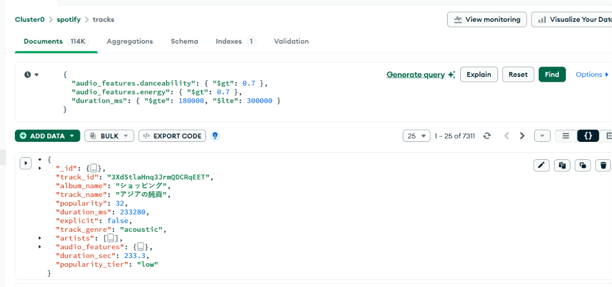
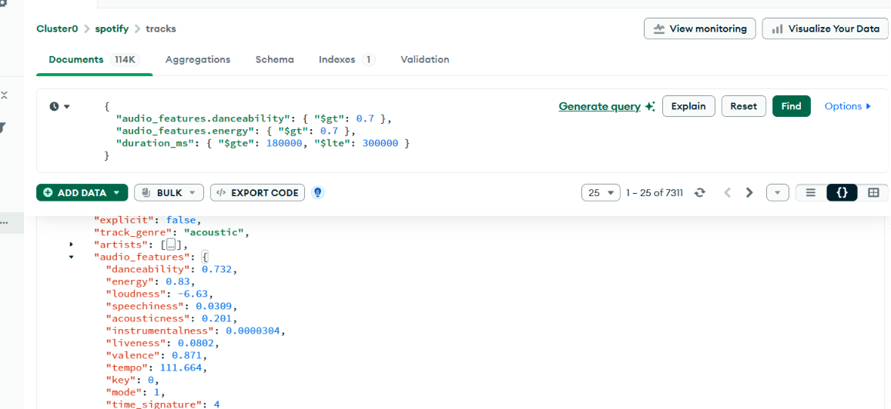
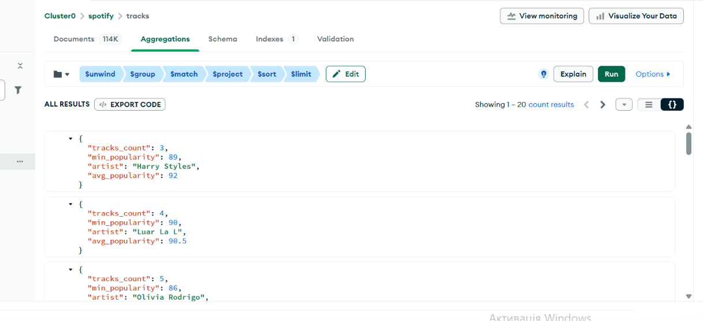
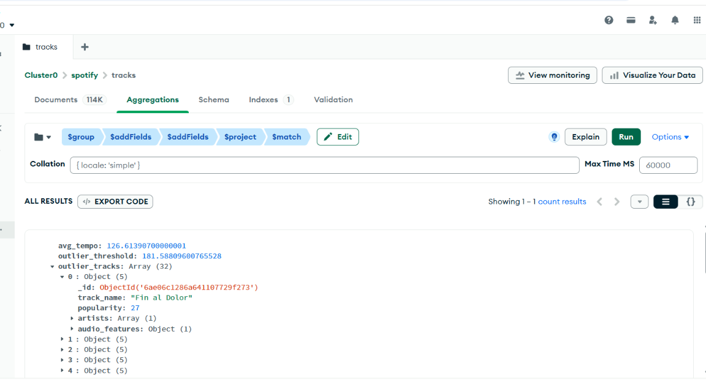
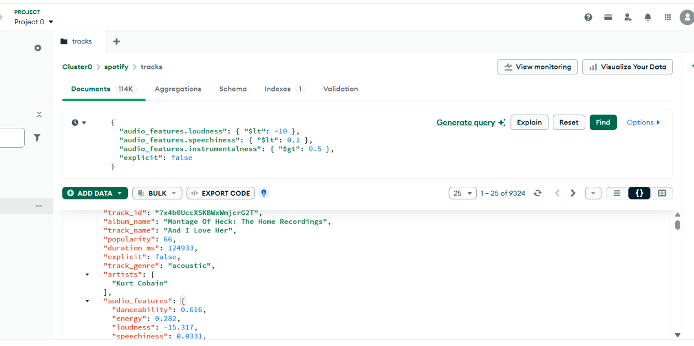

# Hrysiuk_nosql_1

## Налаштування оточення

Створити кластер M0 у MongoDB Atlas. У розділі Database Access створити користувача, у Network Access додати свій IP.
Створити віртуальне середовище: python -m venv .venv. Активувати його і встановити залежності: pip install -r requirements.txt.
Завантажити датасет Spotify Tracks з Kaggle і покласти файл dataset.csv у корінь проєкту.
Створити файл .env з рядком підключення: MONGO_URI=mongodb+srv://користувач:пароль@кластер.mongodb.net/ (файл .env додано в .gitignore, у репозиторій він не потрапляє).
Запуск за порядком:
python scripts/01_load_data.py завантажує сирі дані в колекцію tracks_raw;
mongosh “MONGO_URI” --file scripts/02_transform.js створює колекцію tracks;
mongosh “MONGO_URI” --file queries/part2_queries.js запускає запити частини 2.

## Схема даних

База spotify, колекція tracks (близько 114 тисяч документів). Поля документа:
track_id, track_name, album_name, explicit, popularity, duration_ms, duration_sec, popularity_tier, track_genre, artists (масив рядків), audio_features (вкладений об'єкт з 12 полями: danceability, energy, loudness, speechiness, acousticness, instrumentalness, liveness, valence, tempo, key, mode, time_signature).

{
  track_id: '7k9GuJYLp2AzqokyEdwEw2',
  album_name: 'Hunger',
  track_name: 'Hunger',
  popularity: NumberInt('56'),
  duration_ms: NumberInt('205594'),
  explicit: false,
  track_genre: 'acoustic',
  artists: [
    'Ross Copperman'
  ],
  audio_features: {
    danceability: Double('0.442'),
    energy: Double('0.632'),
    loudness: Double('-6.77'),
    speechiness: Double('0.0295'),
    acousticness: Double('0.426'),
    instrumentalness: Double('0.00419'),
    liveness: Double('0.0735'),
    valence: Double('0.196'),
    tempo: Double('78.899'),
    key: NumberInt('1'),
    mode: NumberInt('1'),
    time_signature: NumberInt('4')
  },
  duration_sec: Double('205.6'),
  popularity_tier: 'medium'
}

## Відповіді на теоретичні питання (частина 1)

### 1. Чому аудіохарактеристики винесені в окремий об'єкт audio_features, а не зберігаються плоско? Коли таке вкладення вигідне, а коли створює проблеми?
Вкладення вигідне, коли характеристики потрібні разом, одним блоком: можна вивести весь блок цілком, не перелічуючи 12 полів, а опис треку (назва, альбом, жанр) лежить окремо. Вкладення створює незручності, коли треба працювати з окремим полем: шлях до нього довгий (audio_features.energy), і в запиті легко зробити помилку (зайва крапка, неправильна назва). Для частих пошуків за таким полем потрібен індекс саме на вкладений шлях.

### 2. Чому виконавці зберігаються як масив, а не як рядок? Які запити стають простішими?

Масив дозволяє шукати виконавця за точним збігом елемента. Запит artists: “Future” знайде трек з масивом Drake, Future, але не знайде Future Islands. Для рядка “Drake;Future” довелося б шукати підрядок регулярним виразом, і в результат потрапили б зайві треки. Також масив можна розгорнути етапом $unwind і порахувати статистику по кожному виконавцю окремо (так зроблено в завданні 2). Мінус: $unwind збільшує кількість документів у конвеєрі, на великій колекції це дорожче.

## Частина 2. Запити

Завдання 1. Треки для вечірки. Запит find з трьома умовами: danceability більше 0.7, energy більше 0.7, тривалість від 180000 до 300000 мс. Умови через кому діють як AND, межі тривалості включені ($gte і $lte). Результат: 7311 треків.

{
  "_id": {
    "$oid": "6ae06c1186a6411077292f70"
  },
  "track_id": "3XdStlaHnq3JrmQDCRqEET",
  "album_name": "ショッピング",
  "track_name": "アジアの純真",
  "popularity": 32,
  "duration_ms": 233280,
  "explicit": false,
  "track_genre": "acoustic",
  "artists": [
    "Yosui Inoue",
    "Tamio Okuda"
  ],
  "audio_features": {
    "danceability": 0.732,
    "energy": 0.83,
    "loudness": -6.63,
    "speechiness": 0.0309,
    "acousticness": 0.201,
    "instrumentalness": 0.0000304,
    "liveness": 0.0802,
    "valence": 0.871,
    "tempo": 111.664,
    "key": 0,
    "mode": 1,
    "time_signature": 4
  },
  "duration_sec": 233.3,
  "popularity_tier": "low"
}

Завдання 2. Виконавці, у яких усі треки популярні. Етап $unwind по artists робить з кожного треку окремий рядок для кожного виконавця. Етап $group рахує кількість треків, мінімум і середнє popularity. Етап $match залишає виконавців з щонайменше 3 треками та мінімальною популярністю від 60. Це умова на групу, тому $match стоїть після $group. Етап $project перейменовує _id у artist і округлює середнє до одного знака. У завданні не сказано, за чим вважати топ-20, тому сортування зроблено за середньою популярністю, а при рівності за кількістю треків. Результат: 20 виконавців.

Завдання 3. Нетипові треки. Етап $group по track_genre рахує $avg та $stdDevPop для audio_features.tempo і збирає треки жанру в масив через $push. Перший $addFields обчислює поріг: avg_tempo плюс два std_tempo. Другий $addFields через $filter залишає треки з темпом вище порогу (потрібні два етапи, бо поле порогу не можна використати в тому ж етапі, де воно створюється). Етап $project залишає genre, avg_tempo, outlier_threshold, outlier_tracks. Перевірка на розумність: у жанрі з 1000 треків нетипових приблизно 3 відсотки (наприклад, 32 у heavy-metal), це відповідає очікуванню для порогу середнє плюс два відхилення.

Завдання 4. Треки для фонової роботи. Запит find з умовами loudness менше -10, speechiness менше 0.1, instrumentalness більше 0.5, explicit дорівнює false (булеве значення без лапок). Межі строгі, тому використано $lt і $gt. Результат: 9324 треки.

{
  "_id": {
    "$oid": "6ae06c1186a6411077292e41"
  },
  "track_id": "7x4b0UccXSKBWxWmjcrG2T",
  "album_name": "Montage Of Heck: The Home Recordings",
  "track_name": "And I Love Her",
  "popularity": 66,
  "duration_ms": 124933,
  "explicit": false,
  "track_genre": "acoustic",
  "artists": [
    "Kurt Cobain"
  ],
  "audio_features": {
    "danceability": 0.616,
    "energy": 0.282,
    "loudness": -15.317,
    "speechiness": 0.0331,
    "acousticness": 0.983,
    "instrumentalness": 0.833,
    "liveness": 0.13,
    "valence": 0.435,
    "tempo": 96.638,
    "key": 1,
    "mode": 1,
    "time_signature": 4
  },
  "duration_sec": 124.9,
  "popularity_tier": "medium"
}

